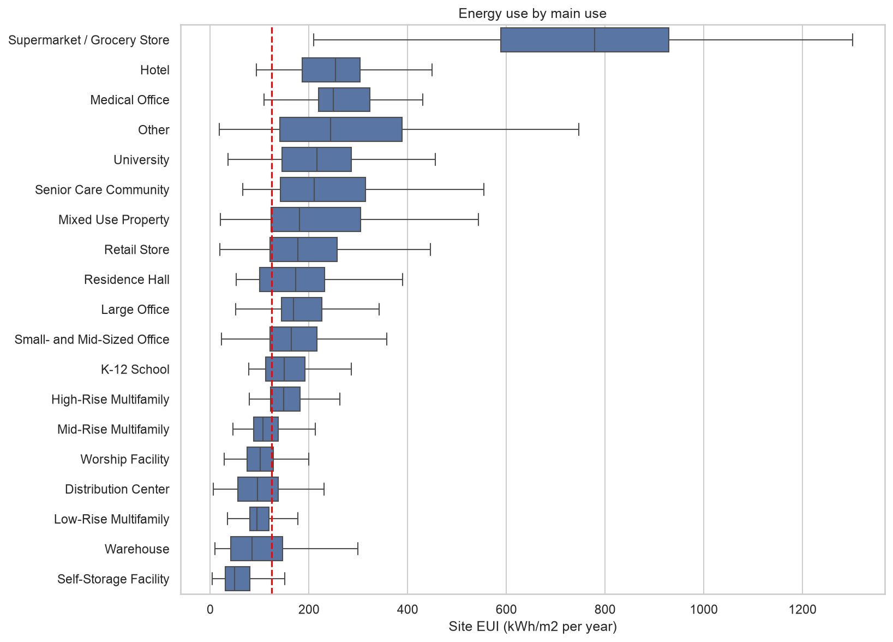
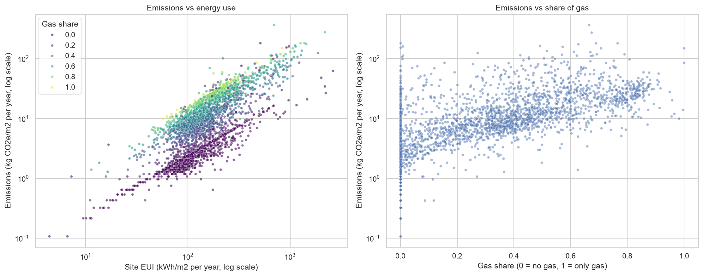
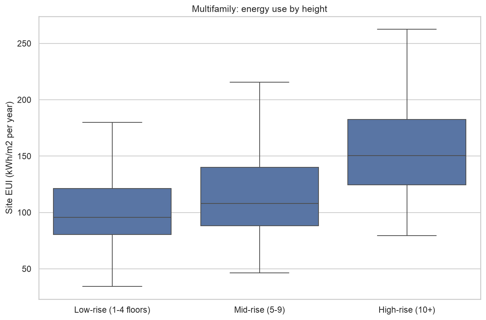

# Seattle buildings: energy use and emissions

Chloe Hraibeh, Jeff El Khoury, Luca Obejdeanu
AI Methods I, Day 1 (data cleaning + EDA), IAAC MaAI 2026/27

Our first version (with another dataset) is on the `chloe-v1` branch.

## Question

What makes some buildings use more energy and emit more CO2 than others? We look at use, age, height and type of energy, using Seattle's 2016 building energy report.

## Dataset

| | |
|---|---|
| Name | 2016 Building Energy Benchmarking (Seattle) |
| Source | Kaggle, [city-of-seattle/sea-building-energy-benchmarking](https://www.kaggle.com/datasets/city-of-seattle/sea-building-energy-benchmarking) |
| One row | one building |
| Raw | 3,376 rows, 46 columns |
| Clean | 3,211 rows, 23 columns |
| Licence | Public Domain |

## Repo

```
data/         raw data (downloaded by the notebook, not on github) + seattle_buildings_clean.csv
figures/      plots
notebook/     data_cleaning_and_EDA.ipynb
.gitignore
LICENSE
README.md
requirements.txt
```

## How to run

```bash
python -m venv .venv
source .venv/bin/activate        # Windows: .venv\Scripts\activate
pip install -r requirements.txt
```

Open `notebook/data_cleaning_and_EDA.ipynb`, select `.venv` and run all. The first cells download the data from Kaggle.

## Cleaning

| Check | Found | Done |
|---|---|---|
| Duplicates | none | - |
| Empty / useless columns | 23 | dropped |
| Not compliant buildings | 165 | removed |
| Spelling | neighborhoods, building types | fixed |
| Impossible values | buildings with 0 floors, a church with 99 floors | NaN |
| Negative energy | Bullitt Center (solar) | kept |
| Outliers | 244 buildings way above the rest, but they're supermarkets, hospitals, data centers etc | kept |
| Missing ENERGY STAR | 25%, some building types just don't get a score | NaN |

## Findings

- use matters most: supermarkets use about 16x more energy per m2 than self storage
- old housing uses more, offices don't really change with age
- gas buildings use 2x more energy but emit 11x more CO2 (Seattle's electricity is mostly hydro)
- taller housing uses more per m2, but it also uses more gas so it's not only the height







## Limitations

- only big buildings, one city, one year
- self reported data
- no info on renovations, insulation, heating or occupancy

## Ready for modelling

We'd predict `site_eui_kwh_m2`. Can't use the energy, gas or emissions columns as inputs, they come from the same bills.

## AI usage

| | |
|---|---|
| Tools | Claude Code |
| Why | our first dataset turned out to be fake (synthetic) so we needed a new one fast, and to go faster with the code |
| Where | it suggested the Seattle dataset and the questions, and wrote most of the code, plots and first drafts of the texts and README |
| How | we went through every cell and asked it to explain each step. Code is mostly the same functions as in class and DataCamp. Checked the numbers and ran everything again at the end |

Lessons learned: asking why for every step helped us actually get the cleaning. Also check your dataset properly before using it, our first one looked clean but was fake.

## License

MIT for the code, the data is public domain.
